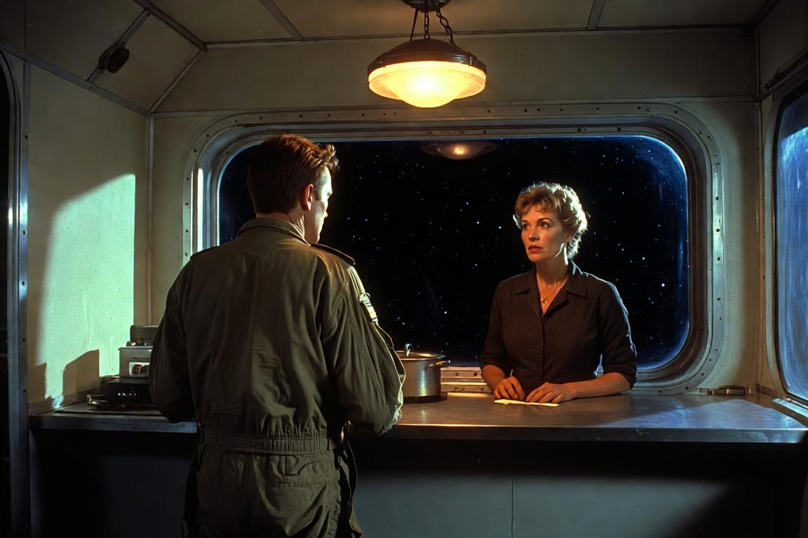

Margarete looked after the sign of a restaurant in a corner of the galaxy where ships almost always arrived by mistake and almost never came back. Saying she looked after it is generous. She looked at it every morning, cleaned it when it needed cleaning and knew better than anyone what it said. What she could not do was change it. That day, as for months, the sign said only one thing: that soup was being served.

There was no soup. Margarete knew it. The kitchen knew it. Probably even the pot knew it. The only one that didn't know was the sign, and the sign did not depend on Margarete but on an office on another planet, the only one authorized to decide what the signs of that sector announced. Margarete had sent the correction three times. The office opened on alternate Tuesdays of a calendar nobody else used. The person in charge might be on holiday, or dead, or simply convinced that a sign that changes is a sign nobody trusts. All three times she got the same acknowledgement: her request had been registered and would be handled in strict order of arrival, which, given the speed of light and the speed of the office, was not a promise but a description of the universe.

A ship arrived on a Thursday. The pilot had planned the afternoon around the soup, which is the kind of plan that only seems small until it fails. He came in, ordered it, and Margarete explained, with the kindness of someone who has had this conversation before, that the soup was a mistake. Not a mistake of the kitchen. A mistake of the sign. And that the sign was not hers, even though it was nailed to her wall.

:::figure[Margarete crosses the soup off the sign. The pilot watches.]

:::

The pilot was not surprised. He had crossed more systems than most people can name and had seen signs announcing ports long since demolished, fares from another century and, on one memorable occasion, an entire planet that had decided not to exist at weekends. He had learned that the problem is almost never the sign. It is who has permission to touch it. So instead of complaining, which is what travellers with fewer miles do, he took out of his pocket a device that looked like a tablet, somewhat worn, with large, friendly letters on the cover.

It was, he explained, a window onto a network like the internet, only better: a network that connected everything in the universe, from the farthest ports to the restaurants nobody reached on purpose. It ran on the *Infinite Improbability Drive*, which almost everyone, almost everywhere, simply called Infinite Drive: the same mechanism that moved his ship and that consists, in short, of making what almost never happens happen just when it is needed. Thanks to it, many of the universe's great problems had been solved, or at least all those that consisted of waiting for someone, on another planet, to give permission.

The pilot showed her how it worked. The sign no longer depended on the office: it lived in a shared ledger that everyone could read. Every change stayed written down, with the name of whoever made it, in an order anyone could follow. And whoever had something to correct corrected it in plain sight.

Margarete waited for someone to ask her for a form. Nobody did. She wrote the correction on the pilot's tablet, in the same ledger where the sign lived, with her name beside it, and that same day the ships coming in read a new notice: no soup today. Nobody had to believe the pilot. Nobody had to believe Margarete. Nobody had to wait for the office. It was enough to look at the sign.

As was to be expected, someone asked whether the soup had ever existed. The ledger had the answer: first the sign announcing soup and then Margarete's correction, each thing in its order.

Weeks later a letter from the office on the other planet reached the restaurant, on paper and with three stamps, to say that the request was still in the queue. Margarete read it, folded it carefully and used it to steady the wobbly table, which was the most useful thing the office had done for the restaurant in years.

In the ledger, Margarete added one last small note: all of it had happened on a Thursday. On that, for once, everyone agreed.
